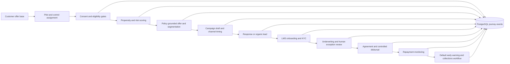

# Loan lifecycle pilot

Streamlit pilot for offer selection, campaign orchestration, loan onboarding, underwriting, disbursal controls, and collections. It uses **synthetic data and illustrative policy**, so it cannot make live credit decisions or send messages.

The campaign screen defaults to test mobile `8050702529` and provides manual WhatsApp, SMS, and phone dialer links with a generic test script. These links open your own app; you must press Send or Call there. Twilio or Airtel IQ voice can place one API test call once the chosen provider is configured. The app does not have credentials for Airtel SMS or WhatsApp APIs.

## Flow



## Run

```powershell
python -m venv .venv
.\.venv\Scripts\python.exe -m pip install -r requirements.txt
.\.venv\Scripts\python.exe -m streamlit run app.py
```

Set `DATABASE_URL` to a PostgreSQL connection string to persist customers, applications, and journey events there. Without it, the app uses a local SQLite demo database. The database schema is initialized on first run.

## Airtel IQ test call setup

In the PowerShell session used to launch Streamlit, set these values from **your Airtel IQ account documentation**:

```powershell
$env:AIRTEL_VOICE_ENDPOINT = "https://<your-airtel-voice-send-endpoint>"
$env:AIRTEL_VOICE_AUTH_VALUE = "<complete authorization header value>"
$env:AIRTEL_VOICE_AUTH_HEADER = "Authorization"
$env:AIRTEL_VOICE_PAYLOAD_TEMPLATE = '<your Airtel JSON request with {{phone}} at the recipient field and an approved call-flow identifier>'
```

`AIRTEL_VOICE_PAYLOAD_TEMPLATE` must be valid JSON. The app substitutes `{{phone}}` with `+918050702529` . Airtel's public pages describe outbound dialer and IVR capabilities, but the call request fields are account-specific; use the exact schema from your portal. The test button requires a confirmation checkbox, restricts calling to this one number, and uses a 09:00–19:00 IST window by default. Override that window with `CAMPAIGN_START_HOUR` and `CAMPAIGN_END_HOUR` if your approved operating hours differ. HTTP acceptance is logged, but actual call delivery and outcome must be checked in Airtel's portal.

For a sample without provider credentials, open **Campaign agent**, select **WhatsApp**, **SMS**, or **Voice bot**, then use the launch link. A desktop without an SMS or calling app may not handle `sms:` or `tel:` links; open the Streamlit app on a phone in that case. The sample text does not claim that a real customer is eligible.

## Production integration path

Replace the synthetic generator with consented Bajaj, bureau, and account aggregator feeds; load approved policy passages with version and effective dates; validate and calibrate trained models on historical outcomes; connect compliant campaign vendors with delivery receipts; add authentication, role based access, encryption, retention, and approval controls; integrate KYC, e-sign, payments, core LMS, and disbursal APIs. Run the pilot as a randomized treatment and control experiment and monitor approval, take-up, loss, collection, fairness, complaints, and contribution margin together. No live outreach or disbursal should use demo scores or placeholder policy.

## Twilio voice bot POC

The app can read Twilio credentials from an ignored local file: copy `.streamlit/secrets.example.toml` to `.streamlit/secrets.toml`, then fill in the Account SID, Auth Token, and international voice caller number. Never post the Auth Token in chat. Environment variables with the same names also work.

Run the app locally:

```powershell
.\.venv\Scripts\python.exe -m streamlit run app.py --server.address 127.0.0.1
```

Open **Campaign agent → Voice bot**, confirm authorization, and click **Place Twilio voice bot call**. The destination is fixed to `8050702529`. Trial accounts use Twilio's hosted text-to-speech sample. After upgrading the account, set `TWILIO_TRIAL_MODE = false` in `secrets.toml` to use the inline custom campaign script. Neither mode records speech or carries out a two-way conversation. The request ID is logged; check Twilio's call logs for delivery and duration.

Twilio's India guidelines require calls to Indian destinations to originate from an international caller number. Trial accounts can call only verified recipients and use limited call request parameters.